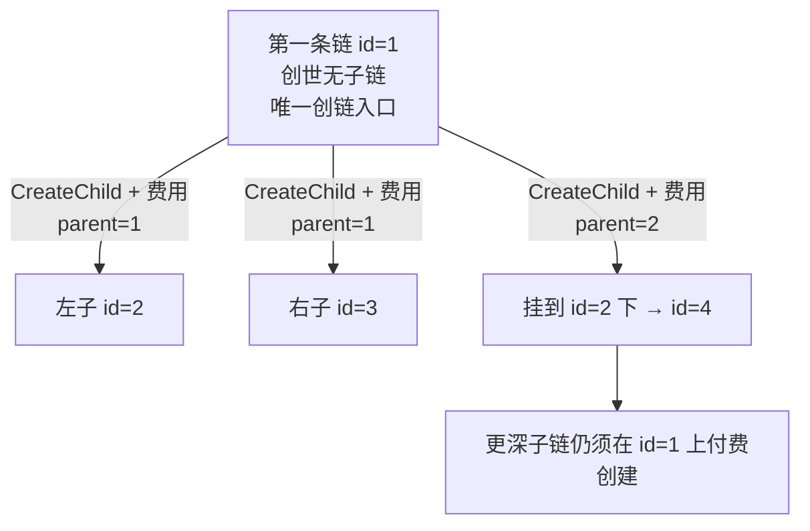
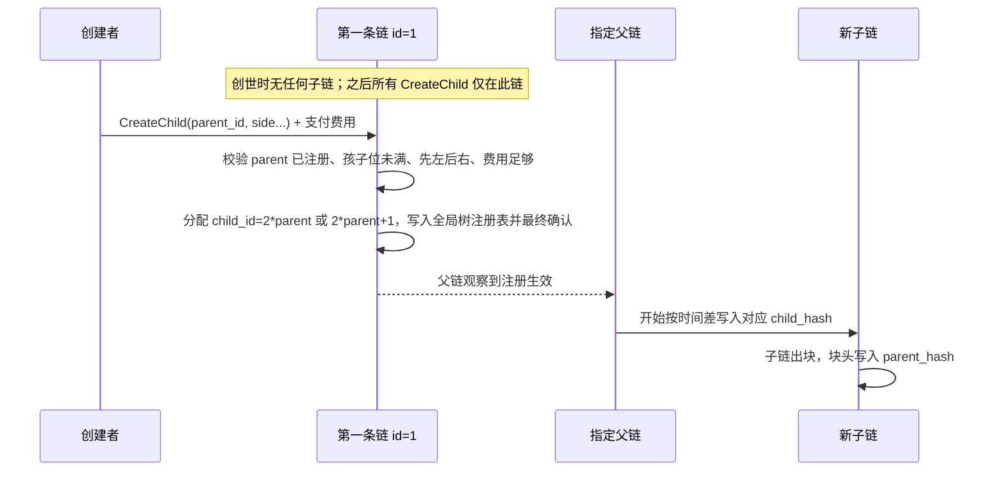
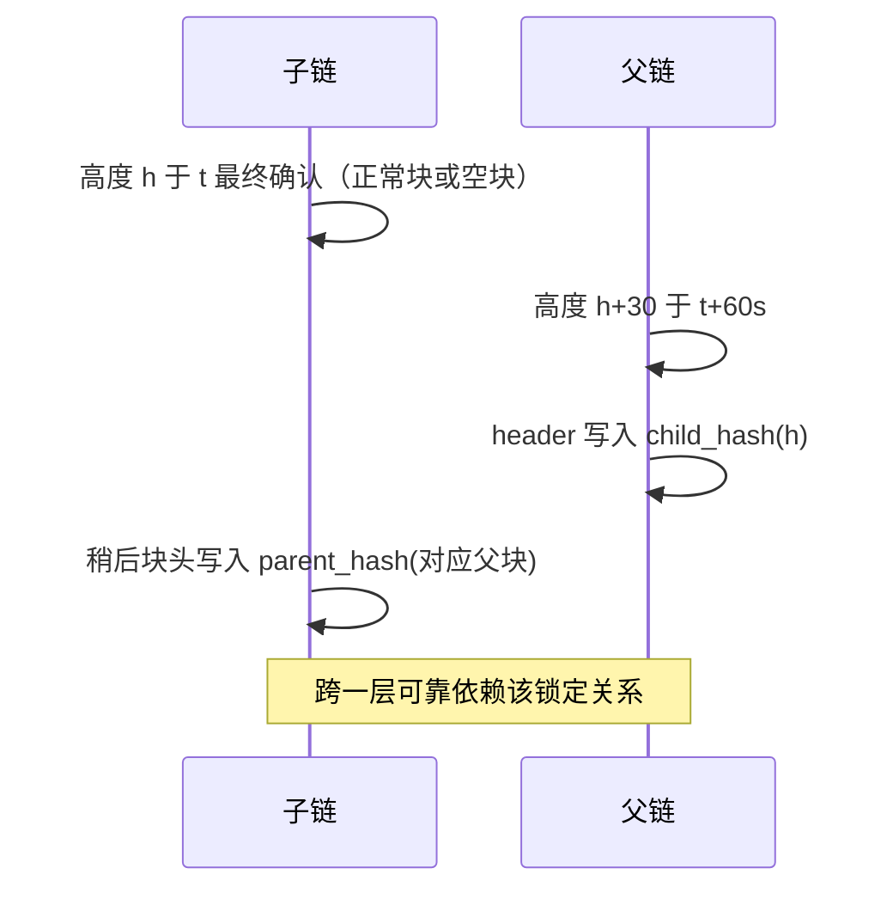
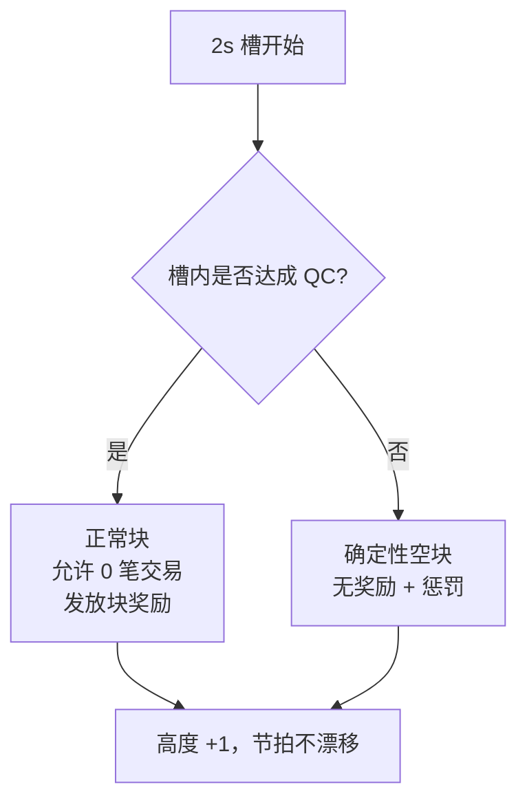
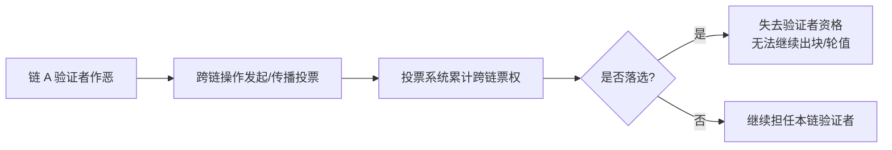

# 主链 + 二叉树分片共识设计

> 日期：2026-07-19  
> 类型：选型 / 架构设计  
> 状态：已对齐需求，待实现立项  

---

## 1. 目标与约束

建设**高性能**区块链系统：

- **主链 + 分片链**；分片区块 hash 写入父链区块头的**定制化属性**
- 验证者：**各链独立集合**（非共享安全）
- 正确性：父链**仅锚定**子块 hash，**不验证**子链状态机（信任子委员会）
- 网络：**开放质押**公链
- 跨层延迟：**接受 ≥60s**

### 1.1 节拍与拓扑（硬约束）

| 约束 | 定值 |
| --- | --- |
| 出块时间 | 全网统一 **固定 2s**（主链与所有分片）；*相对 GOVM 的变间隔做了简化* |
| 拓扑 | **二叉树**（对齐 [GOVM](https://govm-net.github.io/docs/cn/)）：每节点最多 **2** 子链；深度可达很大（GOVM 用 64 位 chain id，最多 \(2^{64}-1\) 条） |
| 创世状态 | **仅有第一条链**（chain id = 1），**无子链** |
| 子链创建 | **一律在第一条链（id=1）上**发创链交易并**支付费用**；交易指定挂载父节点；先左后右（*有意不同于 GOVM 的「在父链创链」*） |
| 父子收录 | 区块头互相写入对方 hash（哈希锁定）；时间差本设计取 **固定 60s**（GOVM 为 4–5 分钟窗口） |



---

## 2. 共识选型结论

| 层级 | 算法 | 说明 |
| --- | --- | --- |
| 所有链（L0/L1/…/Ln，深度不限） | **PoS + HotStuff 族**（明确最终性） | 同族便于实现复用；每层协议相同，仅挂载关系不同 |
| 不采用 | 主链 PoW / 概率最终性 | 锚定重组会破坏跨层语义 |
| 第一版不采用 | 分片侧独立 DAG/PoH | 与独立验证者 + 仅锚定叠加后运维与风险过高 |

**推荐实现参考**：HotStuff / Jolteon（流水线 BFT）+ 质押选主；具体密码学可用 BLS 聚合签名降低 QC 体积。

---

## 3. 角色分工

```mermaid
flowchart TB
  Ln[Ln 叶子：执行负载]
  L1[L1…L(n-1) 中间层：执行 + 锚定子链]
  L0[第一条链 id=1：全局创链入口 + 锚定直接子链]
  Ln -->|child/parent hash 锁定| L1
  L1 -->|规则递归相同| L0
```

- **每一层协议同构**：任意链对其子链都是「父链」角色；**每链只处理父 + 最多两子**（GOVM）
- **子链**：独立委员会出块与执行；即时安全性取决于本链质押；续任资格可受**跨链投票**约束（见 §6.2）
- **信任边界**：父链只保证「某子块 hash 曾被本链最终收录」，不保证子状态正确；深树下路径上**每一层**委员会都是信任短板；跨链投票提供事后落选问责，不改变「仅锚定」语义

### 3.1 区块结构（对齐 GOVM 字段语义）

参考 [GOVM 区块结构](https://govm-net.github.io/docs/cn/wp/3.4.html)，本设计区块头至少包含：

| 字段 | 含义 |
| --- | --- |
| `chain_id` | 本链 ID。第一条链为 **1**；左子 = `parent_id * 2`，右子 = `parent_id * 2 + 1` |
| `prev_hash` | 本链前一区块 hash |
| `parent_hash` | 父链某区块 hash（无父则为空）；须满足时间差约束 |
| `left_child_hash` / `right_child_hash` | 左/右子链某区块 hash（无则空） |
| 元数据 | 时间戳、提议者、QC/签名等（空块除外） |
| 交易列表 | 可为空列表（有 QC 仍算正常块） |

> 每条链**只需关心父链 + 至多两个子链**（GOVM 核心简化点），无需同步整棵树。

### 3.2 子链创建流程（本设计：仅第一条链）

**硬性要求**：无论新链挂在树的哪一层，创链交易都只在 **第一条链（id=1）** 上提交并支付费用。  
（GOVM 是在父链上 `OpsNewChain`——此处**不照搬**。）



**规则摘要**

| 项 | 本设计 | GOVM |
| --- | --- | --- |
| 创世 | 只有第一条链 id=1 | 相同 |
| 创建入口 | **仅 id=1** | 在**父链**上 |
| 费用 | 必须在首链支付创建费 | 在父链支付 |
| 挂载 | 交易指定 `parent_id`（可为 1 或任意已有链） | 隐式为「本链」 |
| 顺序 | 对同一父节点 **先左后右** | 相同 |
| 可选门槛 | 可对首链创链加负载/费率门槛 | 父链平均块大小等 |
| 日常锚定 | 仍由**直接父链**写 `child_hash`，不要求深子块塞进首链头 | 父子各自锁定 |

> 第一条链 = **全局树注册与创链收费**唯一入口；父子哈希锁定仍在相邻链之间完成。

---

## 4. 锚定规则（本设计 60s；GOVM 为 4–5 分钟窗口）

设槽时长 \(2s\)，固定落后 **30 块 = 60s**（相对 GOVM「时间戳差 ∈ (4min, 5min)」的简化版，便于与固定出块对齐）：

- 父块写入的 `left/right_child_hash` 对应约 **60s 前** 的子块
- 子块写入的 `parent_hash` 对应约 **60s 前** 的父块（双向哈希锁定，对齐 GOVM [链间区块关系](https://govm-net.github.io/docs/cn/wp/3.5.html) 思路）
- 子块尚未可见时：对应 child hash 可空，**不阻塞**父链出块



**跨层延迟**：每跨越一层 ≥60s。深度 \(d\) 到根约 **≥ \(60s \times d\)**。  
GOVM 表述为：跨 n 条链最大约 \(n \times 5\) 分钟，用「链间距离 × 最大时间差」判断跨链数据有效性——本设计同构，仅把单层窗口改成 60s。

---

## 5. 区块类型、奖励与惩罚

### 5.1 三类区块

| 类型 | 交易 | 签名 / QC | 奖励 | 惩罚 |
| --- | --- | --- | --- | --- |
| **实块** | 有 | 有 | 正常出块奖励 | 无（作恶另论） |
| **正常块（可无交易）** | 可 0 笔 | **有** | **有** | 无 |
| **空块（确定性占位）** | 无 | **无** | **无人获得** | **有** |

要点：

- **无交易 ≠ 空块**。无交易但完成 HotStuff 并带 QC，仍是正常块，**正常拿奖励**。
- **空块** = 本 2s 槽内**未能**形成带 QC 的块，为维持节拍与 \(H-30\) 可算性而写入的确定性占位块。

### 5.2 空块内容（确定性）

空块体**仅**包含：

- `prev_hash`（前置区块 hash）
- 父子相关 hash 字段（本层对子链 \(H-30\) 的 commit；以及协议规定的父链关联字段，若有）

无交易、无验证者签名。给定前置状态与锚定公式，全网可 **本地算出同一 `block_hash`**。

### 5.3 槽内决策流程



### 5.4 空块惩罚（已选 C）

- **对象**：当前 epoch **全体验证者均摊**
- **效果**：空块无人获得出块奖励，并额外施加协议规定的活性惩罚（具体比例/上下限为经济参数，实现阶段再标定）
- **目的**：把「出不出块」变成委员会共同责任，避免仅罚领导者导致的策略性行为讨论复杂化

> 作恶类惩罚（双签等）仍按可证明过错单独 slashing，与空块活性税分离。

---

## 6. 共识运行细节

| 项 | 设计 |
| --- | --- |
| 槽长 | 固定 2s，与高度一一对应；宁可空块，**不允许节拍漂移** |
| 正常块路径 | 领导者提议 → HotStuff 投票 → QC → 出块奖励 |
| 空块路径 | 槽超时未达成 QC → 写入确定性空块 → epoch 均摊惩罚 |
| 委员会 | 每条链独立质押集合；epoch 内轮换领导者 |
| 规模建议 | L0：约 100–200；更深层级可更小，但**每一层**都设人数与最低质押下限（防弱叶子） |
| 签名 | 正常块使用聚合 QC；空块无签名 |
| 父头负载 | 每块最多 2 个 child commit 槽位（二叉树扇出=2）；**深度无协议上限** |
| 树高 | 由治理/挂载交易决定，协议不截断；实现需支持任意 `chain_id` 路径与递归轻客户端验证 |

### 6.1 开放网络下的配套约束

| 机制 | 作用 |
| --- | --- |
| 每链最低质押 / 最低委员会人数 | 缓解独立验证者下的廉价接管 |
| 主链（父链）登记子链创世与 `child_id` | 防止野链挂载 |
| **仅第一条链受理 CreateChild 并收费** | 全局拓扑唯一真相源；*有意不同于 GOVM* |
| 锚定高度严格按 \(H-30\) 公式 | 拒绝乱序/超前锚定 |
| 双签等可证明作恶 slashing | 安全惩罚与空块活性税分开 |
| **跨链投票（投票系统）** | 各链虽各自验证，作恶者可被跨链投票落选，失去验证者资格 |

### 6.2 投票系统与跨链问责

跨链操作**允许跨链投票**，作为投票系统的一部分，补足「独立验证者 + 仅锚定」下父链不验子状态的安全短板：

- **各自验证不变**：每条链仍由本链委员会独立出块与最终确认；父链仍只锚定子块 hash，不验证子状态机。
- **跨链投票约束验证资格**：若某链验证者作恶（或出现可被社区/协议认定的不当行为），其他链参与者可通过跨链投票对其施压；票权按投票系统规则累计后，可使其**落选**，无法继续担任验证者。
- **定位**：这不是共享安全（不是全局委员会替分片出块），而是**跨链治理/选举通道**——用跨链可传递的投票结果，约束各链本地验证者集合的续任资格。



> 具体票权来源、投票阈值、落选阈值与是否同步 slash 质押，属投票/治理参数，实现前标定；本设计先固定：**跨链投票属于投票系统能力，且可改变验证者续任结果**。

### 6.3 明确不做（本设计范围）

- 欺诈证明 / ZK 有效性证明随锚定提交
- 共享安全（全局验证者池抽签保护所有分片）
- 十秒级跨层 UX

---

## 7. 选型对照（为何是 HotStuff 而非 Tendermint/PoW）

| 候选 | 结论 |
| --- | --- |
| PoW | 否：慢、概率最终性，与固定锚定语义冲突 |
| Tendermint | 可行备选；第一版若求生态/资料也可替换，但流水线与视图切换不如 HotStuff 族灵活 |
| **HotStuff 族** | **首选**：明确最终性、流水线、与 2s 槽模型契合 |
| 分片独用 DAG/PoH | 推迟：复杂度高，且本设计安全短板在委员会而非 mempool |

---

## 8. 风险摘要

1. **独立验证者 + 仅锚定**：叶子作恶时父链会诚实锚定错误状态；即时正确性仍依赖本链委员会。缓解路径：**跨链投票**（投票系统）可使作恶验证者落选、无法续任；极端情形仍可辅以治理应急（停子链/社会共识）。  
2. **空块均摊惩罚**：网络分区时可能连坐诚实节点；需合理上限与 epoch 长度，避免 intrashard 死亡螺旋。  
3. **确定性空块无 QC**：分叉选择规则必须写清「空块何时合法纳入规范链」（建议：仅当该槽超时条件客观可验证时）。  
4. **跨层 ≥60s/层**：产品与桥/钱包确认数需按路径深度计时，不能按单链 2s 宣传跨片体验。  
5. **深度不限**：树越深，累计延迟与「路径上多委员会同时诚实」假设越苛刻；深叶适宜弱跨根、强本地业务，不宜默认把全局结算放在很深的叶子上。  
6. **跨链投票滞后**：投票与落选相对作恶有确认/传播延迟（受跨层时间窗约束），不能替代即时 slashing；作恶窗口期内仍可能造成局部损害。

---

## 9. 需求决策记录

| 决策点 | 选择 |
| --- | --- |
| 验证者关系 | 各分片独立（B）；续任可通过**跨链投票**落选约束 |
| 锚定正确性 | 仅锚定（A） |
| 跨链问责 | 跨链操作允许跨链投票；属投票系统；作恶可被跨链票权落选 |
| 网络 | 开放质押（A） |
| 跨片延迟 | 接受 ≥60s（A），取消 10s 目标 |
| 出块 | 全网固定 2s |
| 拓扑 | 二叉树（扇出≤2），深度大；**创世仅 id=1**；chain id 按 \(2p/2p+1\) |
| 子链创建 | **一律从第一条链** `CreateChild` + **付费**；指定 `parent_id`；先左后右 |
| 父子收录差 | 固定 60s（\(H-30\)） |
| 无交易但有签名 | 正常块，有奖励 |
| 无签名确定性占位 | 空块，无奖励 + 惩罚 |
| 空块惩罚对象 | epoch 全体均摊（C） |
| 共识算法 | 各层 PoS + HotStuff 族 |

---

## 10. 后续实现前待标定参数（非共识算法本身）

- 出块奖励数额、空块均摊罚金上下限  
- **CreateChild 创建费用**公式（可参考 GOVM：与块奖励、平均块大小相关）  
- epoch 长度、领导者轮换策略  
- 各深度委员会规模与最低质押（可随深度递减，但不得低于下限）  
- 空块「超时」的客观判定阈值（网络延迟假设）  
- 跨层消息 / `logSync` 类对象与沿路径有效性（距离 × 单层时间窗）  
- 是否引入 GOVM 式「平均块大小」创链门槛  
- 双向 `parent_hash` / `child_hash` 的精确高度对齐公式  
- **跨链投票**：票权来源、发起条件、落选阈值、与本链选举/epoch 的衔接、是否叠加 slash  


---

## 11. 与 GOVM（孚衍）对照

资料：[官方介绍](https://govm-net.github.io/docs/cn/) · [GitHub govm-net/govm](https://github.com/govm-net/govm)（已 archive）

| 维度 | GOVM | 本设计 | 态度 |
| --- | --- | --- | --- |
| 多链拓扑 | 二叉树，id 从 1，左 \(2p\) 右 \(2p+1\)，最多 \(2^{64}-1\) | 同构 | **采用** |
| 节点视野 | 每链只关心父 + 两子 | 同构 | **采用** |
| 区块头 | PreHash / Parent / LeftChild / RightChild | 同构字段 | **采用** |
| 创世 | 仅第一条链 | 相同 | **采用** |
| 创链入口 | 父链上 `OpsNewChain` | **一律在第一条链**上创建并付费 | **不照搬**（按本设计要求） |
| 创链其它 | 先左后右；可有块大小门槛；花费代币 | 先左后右；首链收费；可选门槛 | **部分采用** |
| 父子锁定 | 哈希互相锁定；时间差 **4–5 分钟** | 哈希双向锁定；时间差 **固定 60s** | **借鉴思路，窗口按你的 60s** |
| 出块间隔 | 首链约 1 分钟；子链为父的 15/16，越深越快 | **全网固定 2s** | **按你的约束，不跟 GOVM 变间隔** |
| 共识 | **POW + DPOS**（矿工出块，监督节点可出空块、调参、举报） | **PoS + HotStuff**（明确最终性） | **有意不同**：开放网络下更贴「2s 硬最终 + 独立委员会」 |
| 空块 | 监督节点在矿工未出合格块时生成空块，防阻塞 | 无 QC 的确定性占位空块；**无奖励 + epoch 均摊惩罚**；无交易但有 QC 仍算正常块有奖 | **有意不同**（你已定奖惩模型） |
| 跨链 | 相邻链转账 + 合约跨链读；确认与距离×时间窗相关 | 同思路：距离 × 60s | **采用有效性模型** |
| 同构代币 | 全网同一代币可跨链转移 | 建议同样做同构资产模型 | **建议采用** |

### 11.1 共识为何不照搬 GOVM 的 POW+DPOS

1. 你要求 **固定 2s** 与 **明确跨层锚定**：BFT 最终性比 PoW 最长链更易保证「已写入的 parent/child hash 不被浅重组打掉」。  
2. GOVM 用监督节点补空块，偏 **DPOS 治理角色**；你已定义空块惩罚均摊，更贴近 **委员会活性税**，与 HotStuff 超时→空块自然衔接。  
3. 多链 + PoW 时，算力在深树上的分配与攻击面更复杂（GOVM 白皮书亦提到纯 POW/POS 多链的问题，才走向 DPOS+POW）。本设计用**每链独立质押委员会**换取实现清晰度（代价是弱叶子风险，需最低质押）。

### 11.2 建议从 GOVM 借鉴（不含创链入口）

1. **Chain ID 算术编号**（左 `2p`、右 `2p+1`）  
2. **先左后右**挂载顺序  
3. **创链费用**可随拥堵调节（防刷链；费用在**首链**收取）  
4. **跨链数据有效性** = 链间距离 × 单层最大时间窗  
5. 区块头四哈希：`prev` + `parent` + `left_child` + `right_child`  
6. 每链只同步父 + 两子  

**明确不采用**：在父链本地创链（GOVM 方式）。

---

*本文档与 `区块链共识算法分析.md` 配套；拓扑与哈希锁定可参考 GOVM，创链入口与共识层按本项目约束定制。*
