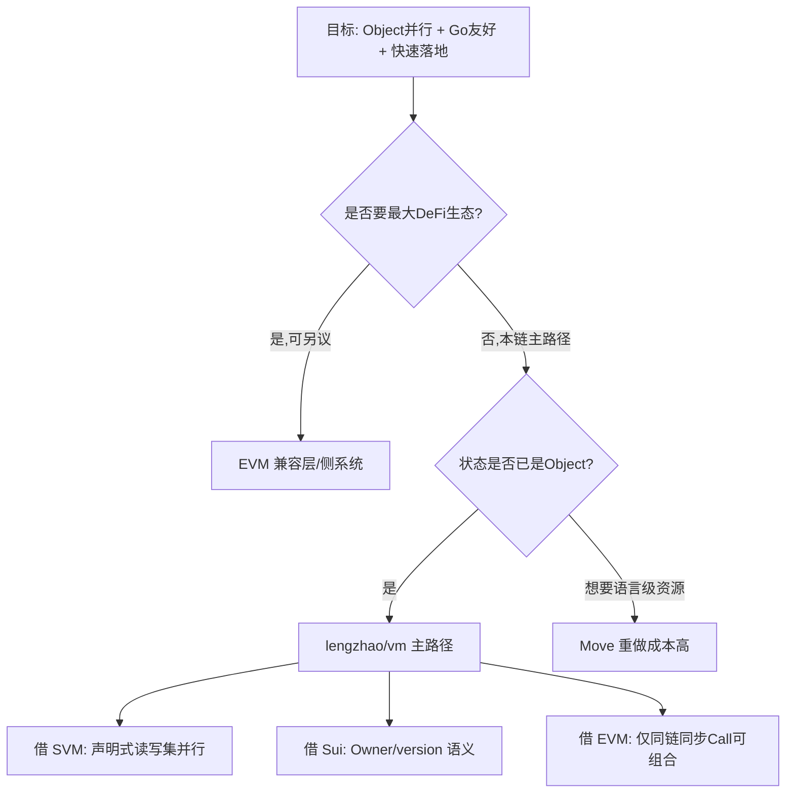
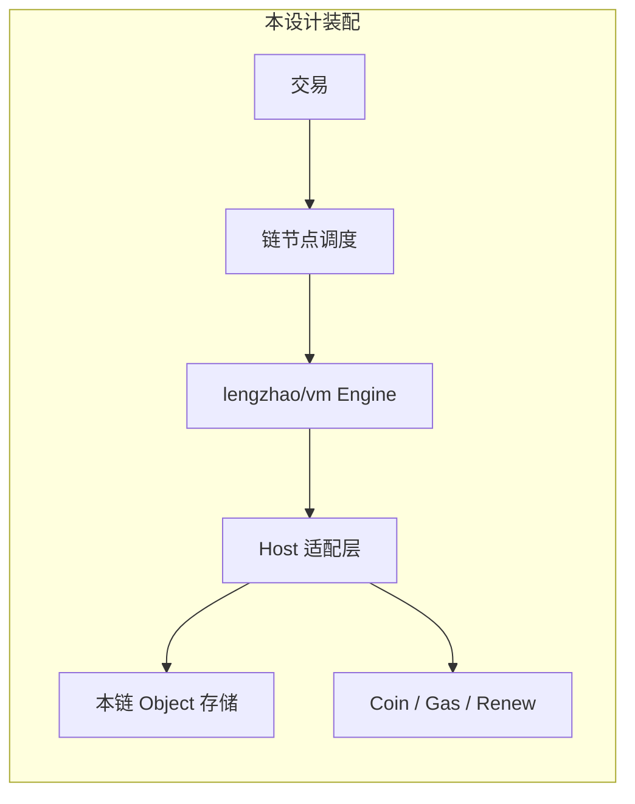
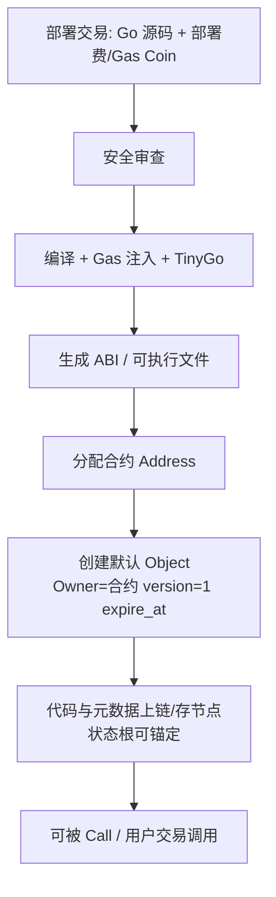
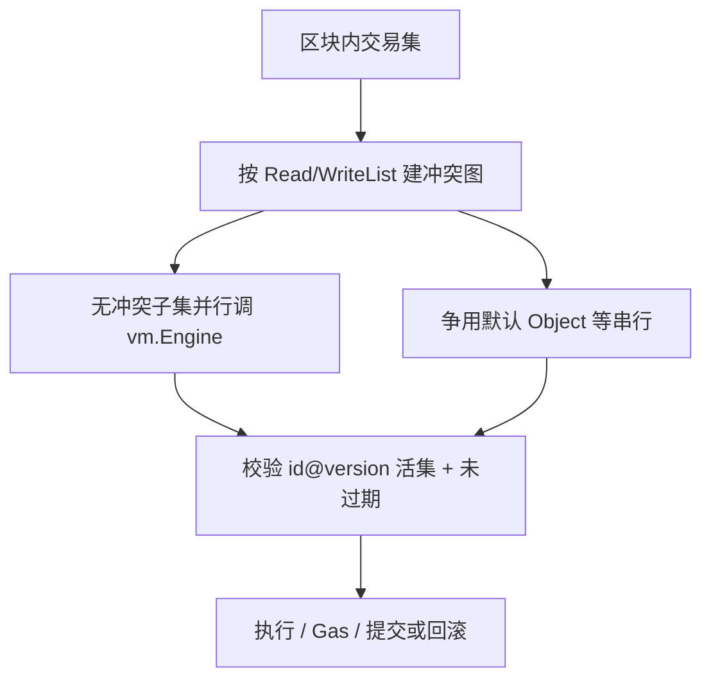

# 智能合约设计（单链 · 基于 lengzhao/vm）

> 日期：2026-07-19  
> 类型：合约 / VM 适配设计  
> 状态：已对齐（跨链 Call = 第一版不做；执行方案见 §0 选型结论）  
> 关联：  
> - `2026-07-19-主分片共识-design.md`  
> - `2026-07-19-账户类型-design.md`  
> 上游参考：[lengzhao/vm docs](https://github.com/lengzhao/vm/tree/main/docs)（以链接为准，本文只写**本链差异与装配**）

---

## 0. 主流合约方案对比与本链选型

### 0.1 主流方案一览

| 方案 | 代表链 | 语言/形态 | 状态模型 | 并行 | 生态 | 与本链契合度 |
| --- | --- | --- | --- | --- | --- | --- |
| **EVM** | Ethereum、多数 L2 | Solidity → 字节码 | 账户 + 合约存储槽 | 弱（主路径串行） | 最强 | 低：与 Object/`version`/声明式并行冲突大 |
| **SVM** | Solana | Rust → BPF | 程序无状态，账户显式传入 | 强（Sealevel） | 强 | 中高：并行哲学接近，但工具链/账户模型需重做 |
| **MoveVM** | Sui、Aptos | Move | 资源/对象一等公民 | 强（所有权） | 中 | 高（状态观接近），但语言与现有 Go VM 路线分叉 |
| **WASM** | CosmWasm、NEAR、部分 Substrate | Rust 等 → WASM | 多为合约存储 + 消息 | 中 | 中 | 中：性能好，与 Object Owner 要自研一层 |
| **Go 源码 VM** | [lengzhao/vm](https://github.com/lengzhao/vm) | Go 源码 + TinyGo/沙箱 | 默认 Object + 用户 Object | 靠 Read/WriteList | 弱 | **最高**：已与账户文档同构 |

补充参考：[VM 综论](https://university.mitosis.org/unpacking-blockchains-engines-a-comprehensive-look-at-virtual-machines/)、[EVM/WASM/SVM/CKB 对比](https://www.nervos.org/knowledge-base/comparing_blockchain_virtual_machines)。

### 0.2 各方案要点（架构视角）

**EVM**  
- 优点：工具、审计、流动性、开发者最多；同步 `CALL` 可组合性成熟。  
- 缺点：256-bit 栈机偏慢；全局账户存储天然串行；重入等历史包袱。  
- 对本链：若强行 EVM，会放弃 Object 并行与 `version` 活键优势，等于另做一条「EVM 侧链心智」。

**SVM**  
- 优点：显式账户列表 → 冲突可知 → 多核并行；吞吐导向。  
- 缺点：Rust/Anchor 栈；硬件门槛；可组合模式与 EVM 不同。  
- 对本链：并行调度可借鉴（你们已有 Read/WriteList）；不必整栈换 BPF。

**MoveVM（尤其 Sui）**  
- 优点：对象/资源与资产安全同语言绑定；Owned/Shared 与并行路径清晰。  
- 缺点：Move 生态与人才池小于 Solidity/Go；与 lengzhao/vm 重复建设。  
- 对本链：账户文档已吸收「Owner + 对象版本」直觉，**不必再上 Move 运行时**。

**WASM（CosmWasm 等）**  
- 优点：近原生性能、多语言、Cosmos 应用链常见。  
- 缺点：计量与确定性要额外工程；默认不是 Object-UTXO。  
- 对本链：可作为**远期第二运行时**，不是 v1 最优。

**lengzhao/vm（Go 源码）**  
- 优点：与默认 Object / 用户 Object / 审查白名单 / Gas 注入已对齐；Go 团队上手快；库式嵌入节点。  
- 缺点：生态与审计市场远小于 EVM；源码合约的确定性/供应链要靠沙箱与白名单扛住。  
- 对本链：与已定账户、单链 Call、Coin Object **阻抗最低**。

### 0.3 选型结论（合适方案）



**推荐方案（定稿）**

1. **主执行引擎**：继续 [lengzhao/vm](https://github.com/lengzhao/vm/tree/main/docs)（Go 源码合约 + 沙箱 + Gas）。  
2. **状态与并行**：账户设计（Object / Owner / `version` / 续期 / Coin）+ 交易 Read/WriteList（借 SVM/Sui 调度思想）。  
3. **可组合**：v1 **仅同链**同步 `Call`（借 EVM 可组合，不做跨链 Call）。  
4. **明确不选为 v1 主路径**：纯 EVM、纯 MoveVM、纯 SVM/BPF；避免双栈。  
5. **可选演进**：生态需要时再评估 **EVM 兼容预编译/桥** 或 **WASM 第二运行时**，与主 Object 状态通过适配层互通——不阻塞第一版。

以下各节按该结论做本链装配说明。

---

## 1. 目标与范围

| 项 | 定值 |
| --- | --- |
| 语言 | **Go 源码即合约**（非字节码 DSL） |
| VM | 直接采用 / 集成 [lengzhao/vm](https://github.com/lengzhao/vm) |
| 状态 | 统一走账户文档的 **Object + Owner + version + expire_at** |
| 执行域 | **仅单链**：部署、调用、同链 `Call` |
| 明确不做（v1） | 合约同步跨链 `Call`；跨链资产走共识层消息，不经 VM 跨链调用 |



**文档分工**

| 内容 | 以谁为准 |
| --- | --- |
| 编译管线、沙箱、安全审查、ABI、Gas 注入细节 | [vm docs](https://github.com/lengzhao/vm/tree/main/docs) |
| Owner / version / 续期 / Coin / 并行 ReadWriteList | `账户类型-design.md` |
| 出块、空块、分片树 | `主分片共识-design.md` |
| Host 如何把 vm 默认库接到本链 | **本文** |

---

## 2. 采用 vm 的哪些部分（原文链接）

按 [00_directory_structure](https://github.com/lengzhao/vm/blob/main/docs/00_directory_structure.md) 阅读顺序，本链**整包采用**以下能力：

| 模块 | 文档 | 本链态度 |
| --- | --- | --- |
| 总体架构 | [architecture.md](https://github.com/lengzhao/vm/blob/main/docs/architecture.md) | **采用**：源码合约、审查、沙箱、默认库、并行 Object 模式 |
| 模块划分 | [modular_architecture_design.md](https://github.com/lengzhao/vm/blob/main/docs/modular_architecture_design.md) | **采用**：以库形式嵌入节点 |
| 默认库 | [default_library.md](https://github.com/lengzhao/vm/blob/main/docs/default_library.md) | **采用接口形状**；语义按 §4 适配账户模型 |
| 执行环境 | [execution_environment.md](https://github.com/lengzhao/vm/blob/main/docs/execution_environment.md) | **采用**：TinyGo、沙箱、并行由集成方调度 |
| Gas | [gas_metering.md](https://github.com/lengzhao/vm/blob/main/docs/gas_metering.md) | **采用**计费思路；支付载体改为 Coin Object |
| 安全审查 | [security_review.md](https://github.com/lengzhao/vm/blob/main/docs/security_review.md) | **采用**：白名单 import/关键字、禁全局变量 |
| ABI | [abi_generation.md](https://github.com/lengzhao/vm/blob/main/docs/abi_generation.md) | **采用** |
| 处理流程 | [contract_processing_flow.md](https://github.com/lengzhao/vm/blob/main/docs/detailed_design/contract_processing_flow.md) | **采用**：审查→Gas 注入→编译→ABI→存储 |

详细设计目录 [detailed_design/](https://github.com/lengzhao/vm/tree/main/docs/detailed_design) 作为实现蓝本，本文不重复展开。

---

## 3. 合约生命周期（本链装配）

对齐 [contract_processing_flow](https://github.com/lengzhao/vm/blob/main/docs/detailed_design/contract_processing_flow.md)，部署交易在**当前链**上执行：



| 阶段 | 规则 |
| --- | --- |
| 部署 | 付 Gas（及可选部署费）；审查失败则整笔失败 |
| 默认 Object | 自动创建；Owner=合约地址；承载「全局账户」状态 |
| 调用 | 交易指定 `contract`、`function`、JSON args（vm 约定）；带 Read/WriteList |
| 同链 Call | 合约内 `Call(addr, fn, args...)` 仅允许**本 chain_id** |
| 升级 | v1 建议**不可变代码**；配置放默认 Object 或新建合约迁移 |

---

## 4. 默认库：本链语义适配

接口形状保持 [default_library.md](https://github.com/lengzhao/vm/blob/main/docs/default_library.md)；Host 实现须遵守账户设计。

### 4.1 保留并直通

- `BlockHeight` / `BlockTime` / `ContractAddress` / `Sender` / `User`  
- `Log` / `Assert` / `GetHash`  
- `CreateObject` / `GetObject` / `GetObjectWithOwner` / `DeleteObject`  
- `Object.ID/Owner/Contract/Get/Set/SetOwner`  

### 4.2 必须适配的行为

| API | 本链语义 |
| --- | --- |
| `CreateObject` | 新对象 `version=1`，`expire_at=now+TTL`；Owner 初始为合约或按 API 约定 |
| `Object.Set` / `SetOwner` | **业务写入** → `version+1`；校验 Owner 授权；冻结地址拒绝写 |
| `GetObject(id)` | 仅返回活集且未过期；引用侧用 `(id, version)` |
| `Transfer` | **语法糖** → Coin Object 拆并 + `SetOwner`（见账户文档）；不再假定独立余额表 |
| `Call` | **仅同链**；禁止填其他 `chain_id` 的合约地址 |

### 4.3 本链增补 API（建议）

在默认库同包或 `host` 扩展中增加（名称可调）：

```text
Renew(objectID, extendBy)     // 任何人可调；只延 expire_at；version 不变
SplitCoin / MergeCoin         // 显式 Coin 操作（Transfer 底层用）
```

Gas：执行消耗按 [gas_metering.md](https://github.com/lengzhao/vm/blob/main/docs/gas_metering.md)；**扣费**从交易声明的原生 Coin Object 扣除（账户文档 §3.2）。

### 4.4 与 Owner 规则一致

| Owner | 合约内可写条件 |
| --- | --- |
| 用户 | 外层交易已带该用户签名，且对象在 write_list |
| 合约 | 当前执行栈顶/授权栈为该合约 |
| `FREEZE_ADDR` | 任何 `Set`/`SetOwner` 失败；`Renew` 仍允许 |

---

## 5. 安全模型（采用 vm + 本链加强）

完整规范见 [security_review.md](https://github.com/lengzhao/vm/blob/main/docs/security_review.md)。本链强调：

1. **禁止全局变量** → 状态只进 Object  
2. **import / 关键字白名单** → 无 `unsafe`/系统调用等  
3. **沙箱执行** → 无宿主机文件/网络  
4. **Gas 上限** → 超限回滚（状态先缓存再提交，见 gas 文档）  
5. **声明式并行** → 交易必须带 Read/WriteList；节点判冲突（账户文档 §4）  
6. **单链 Call 边界** → Host 层强制 `callee.chain_id == current`  

---

## 6. 执行与并行（节点侧）

对齐 [execution_environment §6](https://github.com/lengzhao/vm/blob/main/docs/execution_environment.md) 与账户文档：



- 写冲突键：`(object_id, version)`（账户文档已定）  
- 续期交易：目标 Object **可不进** write_list（version 不变）；付费 Coin 进 write_list  

---

## 7. 与共识 / 分片的边界

| 层级 | 合约相关 |
| --- | --- |
| 单链内 | 部署、调用、同链 Call、Object 状态机 |
| 父子链 | **不**跑跨链合约调用；跨链资产/消息由共识锚定与专门交易类型处理 |
| 创链 | 在首链 `CreateChild`（共识文档）；新链有自己的合约与 Object 空间 |

合约地址与 ObjectID 建议带隐式 `chain_id` 命名空间，避免多链 ID 碰撞。

---

## 8. 交易类型（合约相关，示意）

| 类型 | 作用 |
| --- | --- |
| `DeployContract` | 源码部署 |
| `ExecuteContract` | 调用函数 + args + Read/WriteList + Gas Coin |
| `RenewObject` | 任意人为任意 Object 续期（也可由合约 API 触发，效果相同） |

参数编码：与 vm 一致，调用数据可用 JSON（function + args）。

---

## 9. 决策记录

| 项 | 选择 |
| --- | --- |
| VM | lengzhao/vm（Go 源码合约）为主路径；不选 EVM/Move/SVM 作 v1 主引擎 |
| 借鉴 | SVM/Sui 的声明式并行与对象版本；EVM 的同链同步 Call |
| 文档策略 | vm 原文为细则；本文为装配与差异 |
| 跨链合约 Call | **v1 不做**（选项 A） |
| 状态 | 账户设计 Object/`version`/`expire_at`/Coin |
| Transfer | Coin 语法糖，无独立余额账本 |
| Gas 支付 | 原生 Coin Object |

---

## 10. 待标定 / 实现清单

- Host 适配层：Object 存储、签名集、version 校验、单链 Call 守卫  
- 默认库包路径：沿用 `github.com/lengzhao/vm` 或 fork 改模块路径  
- 部署费是否与 Gas 分离  
- 合约代码上链 vs 仅存内容哈希 + 节点存储（GOVM/多链下存储策略）  
- Gas 表是否按账户模型微调（CreateObject/Renew 单价）  
- 白名单是否允许合约 import 同链已部署合约源码模块（vm 流程已支持「可 import 模块」）  

---

## 11. 阅读指引

1. 本文 §1–§4（装配与差异）  
2. [architecture.md](https://github.com/lengzhao/vm/blob/main/docs/architecture.md)  
3. [default_library.md](https://github.com/lengzhao/vm/blob/main/docs/default_library.md) + [security_review.md](https://github.com/lengzhao/vm/blob/main/docs/security_review.md)  
4. [gas_metering.md](https://github.com/lengzhao/vm/blob/main/docs/gas_metering.md) + [contract_processing_flow.md](https://github.com/lengzhao/vm/blob/main/docs/detailed_design/contract_processing_flow.md)  
5. `账户类型-design.md`（状态真相）  
6. 实现时再下钻 [detailed_design/](https://github.com/lengzhao/vm/tree/main/docs/detailed_design)  

---

*本设计 = lengzhao/vm 合约栈 + 本链账户/共识约束；不复制 vm 全文，避免双源漂移。*
