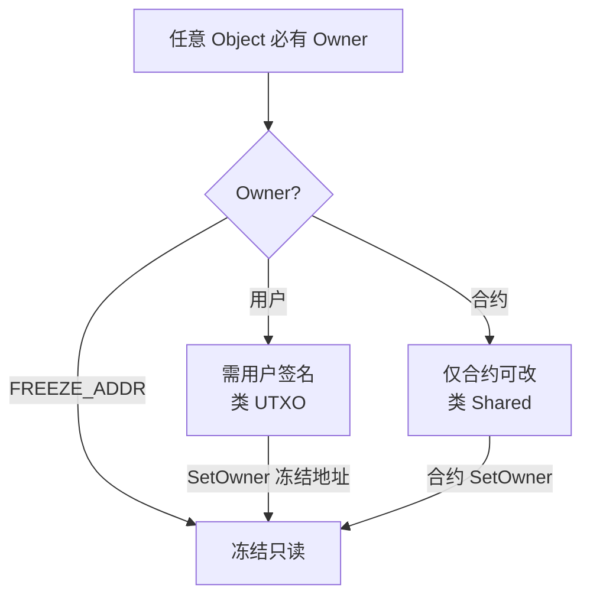
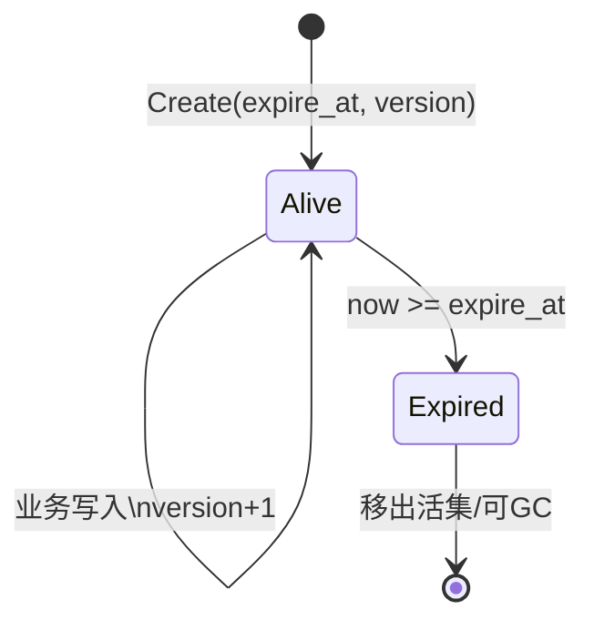
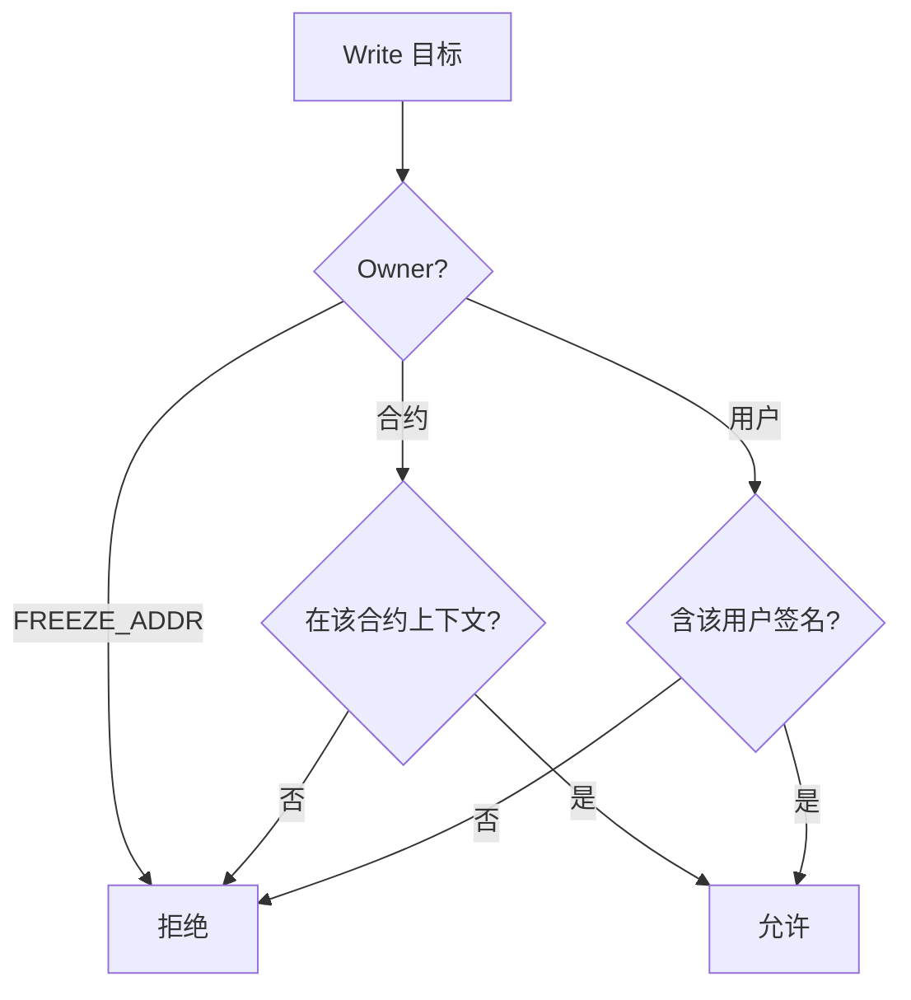
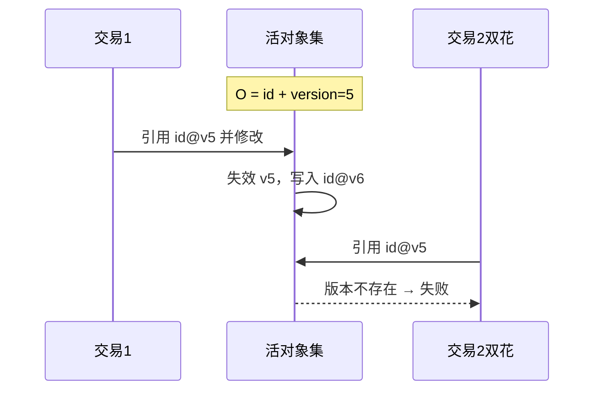

# 账户与 Object 模型设计（单链）

> 日期：2026-07-19  
> 类型：状态/账户模型设计  
> 状态：已对齐需求  
> 关联：`2026-07-19-主分片共识-design.md`（本模型作用于**每一条链内部**）  
> 参考：[lengzhao/vm docs](https://github.com/lengzhao/vm/tree/main/docs)（architecture / default_library / execution_environment）

---

## 1. 目标

在单条链内统一：

- **类 UTXO**：用户拥有的 Object（含原生 **Coin Object**），修改需用户签名  
- **全局账户**：合约默认 Object（Owner=合约），类似 EVM 共享状态，冲突时串行  
- **冻结**：不另设类型，将 Owner 转为协议保留的 **冻结地址**  
- **防状态爆炸**：每个 Object 均有 **有效期**；到期移出活集；**支付费用可续期**

不另建「地址→余额」总账；原生币以 Coin Object 为主。

**对象版本**：活集与防双花以单调 **`version`** 为准（不用 `content_hash` 作活键）。

---

## 2. 核心模型（§1）

### 2.1 唯一状态载体：Object

每个 Object 至少包含（对齐 [default_library Object](https://github.com/lengzhao/vm/blob/main/docs/default_library.md)）：

| 字段 | 含义 |
| --- | --- |
| `id` | 稳定 ObjectID |
| `owner` | 用户地址 / 合约地址 / `FREEZE_ADDR` |
| `contract` | 所属合约 |
| `content` / 字段存储 | `Get`/`Set` 的业务数据 |
| `version` | **单调版本号**；业务写入时 `+1`；创建时为 1（或 0，实现选定） |
| `expire_at` | **有效期截止**（区块时间或高度）；到期后不再属于活集 |
| `updated_at` | 上次**业务**更新时间（可选；续期可不改） |

**账户** = `Address`（签名主体与 Owner），不是独立余额账本。

> **所有 Object（含默认 Object、Coin、已冻结 Object）都必须带有效期**；冻结只禁止改内容/Owner，**不免除**续期义务。

### 2.2 Owner 决定语义（不设 Shared/Immutable 枚举）

| Owner | 行为 | 类比 |
| --- | --- | --- |
| **用户地址** | 修改/转移需该用户**签名** | UTXO / Sui Owned |
| **合约地址** | 仅在该合约执行上下文中可改 | Shared（合约门控） |
| **`FREEZE_ADDR`** | 协议保留、无私钥；写入/再转移禁止 | Immutable（用转 Owner 实现） |

### 2.3 与 vm 双模式的对应

摘自 [architecture §3.6](https://github.com/lengzhao/vm/blob/main/docs/architecture.md)：

1. **统一账户**：状态写入合约**默认 Object**（空 ID，Owner=合约）→ 易冲突 → **串行**  
2. **并行路径**：为用户创建独立 Object（Owner=用户）→ 无读写交集可 **并行**  

权限（architecture §3.7）：可写当且仅当 Owner 为交易发起方（已签名）或当前执行合约。

### 2.4 有效期与续期（防状态爆炸）

| 规则 | 说明 |
| --- | --- |
| 创建 | `CreateObject` / 部署默认 Object / 铸造 Coin 时写入初始 `expire_at = now + TTL_default`，`version = 1` |
| 活集条件 | 仅当 `now < expire_at` 时对象可被 read/write；否则视为**不存在**（与错误 version 一样导致交易失败） |
| 续期 `Renew` | **任何人**均可对**任意** Object 支付续期费并延长 `expire_at`；**不修改业务内容，`version` 不变** |
| 费用 | 续期费可与存储大小、延长时长成正比；从支付者 Coin 扣除（同 Gas 机制） |
| 过期后果 | 移出活集，节点可删除本地存储；**不自动发回**余额（Coin 过期等于该面额消失，除非另设宽限期认领——默认不做） |
| 与冻结 | Owner=`FREEZE_ADDR` 的对象仍可被任何人续期；无人续期则过期回收，避免「冻住即永久占存储」 |
| 与防双花 | 续期**不是**状态突变：活键仍为原 `(object_id, version)`；仅延长 `expire_at`，**不导致旧引用失效** |

**实现提示**：`expire_at` 为侧车元数据（租金索引），**不**因续期而 bump `version`；仅业务 `Set` / `SetOwner` / Coin 拆并等改变内容时 `version += 1`。

---

## 3. Coin Object（§2）

原生币是一类特殊 Object，**不**维护地址余额表。

| 字段 | 含义 |
| --- | --- |
| `id` / `owner` / `contract` / `version` / `expire_at` | 同普通 Object；`contract` 为系统币种合约 |
| `amount` | 面额；变为 0 则删除对象 |

某地址余额 = 其拥有的同币种 Coin 的 `amount` 之和。

业务变更（Split/Merge/Transfer/扣 Gas）→ **`version + 1`**；纯 `Renew` → version 不变。

### 3.1 拆分 / 合并 / Transfer

| 操作 | 规则 |
| --- | --- |
| Split | 消耗输入 Coin（需授权），产出多个新 Coin，金额守恒；输入旧 version 失效，输出新 id+version |
| Merge | 同币种 Coin 合并（Owner 规则满足时） |
| `Transfer(from,to,amount)` | **语法糖**：选 Coin → Split/Merge → `SetOwner(to)` |

### 3.2 Gas

- 用原生 Coin Object 支付；Gas Coin ∈ `write_list`（带当前 `version`）  
- Owner 须为发起方并签名  
- 扣费通过减额/Split，找零留在发起方名下  

### 3.3 冻结

- `SetOwner(FREEZE_ADDR)`（业务写入 → `version + 1`）  
- 之后禁止 `Set`、禁止再 `SetOwner`、禁止作 Gas  
- 默认不可解冻（治理特权另议）  
- **仍须按 §2.4 续期**；冻结≠永久免租金  

### 3.5 Coin 与有效期

- Coin 同样有 `expire_at`；持币人需续期，否则过期后该 Coin 从活集消失  
- 建议钱包在临近过期时自动 `Renew`；合并 Coin 时可取「各输入 expire_at 的保守策略」（例如取 min 再强制续期到统一截止）  

### 3.4 存放边界

| 用途 | 放置 |
| --- | --- |
| 用户持币、并行转账 | Coin，Owner=用户 |
| 合约金库 | Coin，Owner=合约 |
| 合约 kv / 池参数 | 默认 Object，Owner=合约 |
| 永久只读 | 任意 Object → `FREEZE_ADDR` |

---

## 4. 交易、并行与防双花（§3）

### 4.1 交易声明

| 字段 | 含义 |
| --- | --- |
| `read_list` | 只读 `(object_id, version)*` |
| `write_list` | 将修改的 `(object_id, version)*` |
| 签名集 | 覆盖所有「Owner=用户」且出现在 write（及所需授权）中的地址 |

Gas Coin、默认 Object（若写入）必须出现在正确列表中。  
引用对象时校验：活集中存在该 `(id, version)` 且 `now < expire_at`，否则按「对象不存在」失败。  
`Renew`：**不要求**目标进入 `write_list`（**version 不变**）；支付续期费的 Coin 仍进支付方 `write_list`。任何人可续期任意未过期 Object。

### 4.2 写授权

### 4.3 冲突与并行

冲突：一笔的 write 与另一笔的 read∪write 有交集（按 **object_id**，或更严按 `(id, version)`）。

| 模式 | 调度 |
| --- | --- |
| 不同用户 Coin/Object，write 无交 | 可并行 |
| 争用同一默认 Object | 串行 |
| 只读∩只读 | 不冲突 |

由链节点按 Read/WriteList 调度；VM 可被并行调用（[execution_environment §6](https://github.com/lengzhao/vm/blob/main/docs/execution_environment.md)）。

### 4.4 防双花：ID + version（已定稿）

**活对象键** = `(object_id, version)`。

1. 交易输入必须引用当前活的 `version`  
2. Object 一旦被**业务写入**，**旧 version 立即从活集移除**，新状态为 `version + 1`  
3. 双花第二笔仍带旧 version → **该版本对象不存在** → 交易失败  
4. 并行下同一 `(id, version)` 至多被一笔交易写入  
5. **`Renew` 不增加 version**，故续期不会使已广播的 `(id, version)` 引用失效  

> 稳定的是 `object_id`；业务变更时递增的是 `version`。双花失败是因为**旧 version 不在活集**，不是因为 ID 消失。

---

## 5. 地址、默认 Object 与链边界（§4）

### 5.1 地址类型

| 种类 | 说明 |
| --- | --- |
| 用户地址 | 由公钥派生，可签名 |
| 合约地址 | 部署生成；可作 Owner；不可「用户式」签名，靠调用上下文授权 |
| `FREEZE_ADDR` | 协议常量，无私钥 |

### 5.2 合约默认 Object

- 部署时自动创建；空 ObjectID（或约定 ID）取得  
- Owner = 合约地址；初始 `version = 1`  
- 承载「全局账户」状态；多笔争用则串行  
- **同样有有效期**：可被任何人付费续期（version 不变），否则过期不可用  

### 5.3 与主分片的关系

- 本模型 **每条链一份** Object 状态；链间不共享 ObjectID 空间（或加 `chain_id` 前缀）  
- 跨链资产移动走共识文档中的父子锚定 / 跨链消息，不在本文展开  
- 创链、出块等见 `2026-07-19-主分片共识-design.md`  

---

## 6. 决策记录

| 项 | 选择 |
| --- | --- |
| 状态内核 | lengzhao/vm Object（含 Owner） |
| 全局账户 | 合约默认 Object（Owner=合约） |
| UTXO 感 | Owner=用户 + 签名 + `(id, version)` 引用 |
| 冻结 | `SetOwner(FREEZE_ADDR)`，不单列类型 |
| 原生币 | Coin Object 为主；Transfer 为语法糖 |
| 防双花 | 活键 **`(object_id, version)`**；业务写则旧 version 失效 |
| 并行 | Read/WriteList + 对象隔离 |
| 状态租金 | **每 Object 必有 expire_at**；**任何人**可付费 Renew；**续期不改 version**；过期移出活集 |
| 不用 content_hash 作活键 | 已否决；若将来要完整性证明可另加可选 digest，但不参与防双花主键 |

---

## 7. 待标定参数

- `version` 起始值（0 或 1）与溢出策略（u64 足够）  
- `FREEZE_ADDR` 常量取值  
- **TTL_default、按字节计费的续期费率、单次续期上限**（代付已定为任何人可续）  
- 过期 Coin 是否提供短宽限期（默认无）  
- `expire_at` 存储位置（侧车租金索引）  
- 原生币小数位、最小面额、Coin 合并上限  
- 交易未声明却访问对象时的失败策略（严格拒绝 vs 执行期补查）  
- 合约上下文嵌套调用时的 Owner 授权栈规则细节  

---

*与 vm 文档统一：Object + Owner + 默认 Object 双模式；防双花采用单调 version（类 Sui），续期与 version 解耦。*
